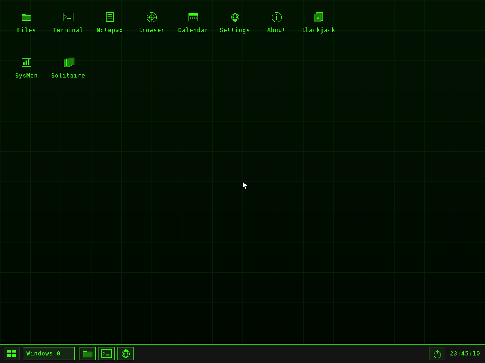
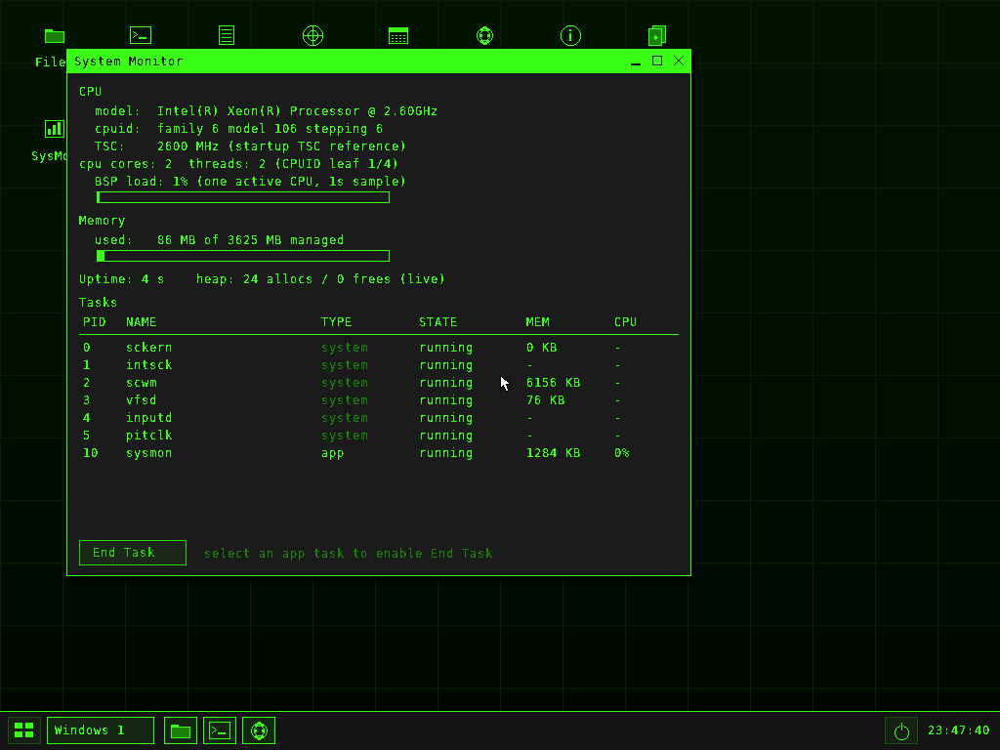

# scoswm — the SCos window manager, ported to Linux

`scoswm` is the desktop/window manager from
[SCos](https://github.com/Joercat/SCos) (a bare-metal x86-64 operating
system) running as an ordinary Linux user process: the SCos desktop —
wallpaper, desktop icons, window decorations, taskbar, launcher,
notifications, themes — in a window on your existing session.

It is **not** a window manager for native Linux applications. Just as on
bare metal, the things that live inside it are SCos's own built-in apps
(File Explorer, Terminal, Notepad, Calendar, Settings, About SCos,
Web Browser notice, Blackjack, System Monitor, Solitaire), drawn by the
SCos software compositor into its own framebuffer. Think of it as the
SCos desktop with a Linux host underneath instead of the SCos kernel.



That screenshot (and the System Monitor one below) was produced by the
headless backend — `make check` regenerates equivalent frames and
asserts on them.



## Run it

On Arch Linux:

```sh
sudo pacman -S --needed base-devel sdl2 pkgconf
make
./scoswm            # windowed (X11 or Wayland, via SDL2)
```

Other distributions use the same `make` — only the SDL2 development
package name differs:

| Distribution | Install build dependencies |
|---|---|
| Arch / Manjaro | `pacman -S base-devel sdl2 pkgconf` |
| Debian / Ubuntu | `apt install build-essential libsdl2-dev pkg-config` |
| Fedora | `dnf install gcc make SDL2-devel pkgconf-pkg-config` |
| openSUSE | `zypper install gcc make libSDL2-devel pkg-config` |
| Alpine | `apk add build-base sdl2-dev pkgconf` |
| FreeBSD | `pkg install gcc gmake sdl2 pkgconf` (use `gmake`) |

If a prebuilt package is more your speed, an (unofficial) Arch package
recipe is included — from this directory:

```sh
makepkg -si        # builds from the git checkout in ./pkgbuild-src
```

or install manually:

```sh
make install                       # /usr/local; use PREFIX= to change
scoswm
```

## Using it

Everything works the way it does in SCos itself, because it is the same
code: drag title bars to move windows, use the corner handle to resize,
double-click desktop icons, right-click for context menus, drag with
either button on the wallpaper to rubber-band-select icons, open the
app launcher from the bottom-left grid button, pin/unpin apps to the
taskbar, switch themes in Settings (Matrix, Blue Sky, Purple,
Matrix red, plus custom palettes), and use the Terminal — its commands
(`help`) operate on the SCos RAM filesystem, exactly as on bare metal.

Host-specific behaviour:

- **Power menu / `shutdown` / `reboot` / Ctrl+Alt+Del** quit `scoswm`
  and return you to your host session. `scoswm` will never reboot or
  power off the machine it runs on.
- **Persistence:** files, theme, desktop layout and pins live in the
  SCos RAM filesystem, snapshotted to
  `$XDG_DATA_HOME/scoswm/vfs.snapshot` (usually
  `~/.local/share/scoswm/vfs.snapshot`). The snapshot is written on
  clean exit and by the Terminal `save` command. Use `--data-dir DIR`
  to put it somewhere else (this is also how you run isolated copies).
- **Size:** `--width`/`--height` choose the desktop size (fixed for the
  session, like the firmware display mode was); resizing the host
  window scales it. `--fullscreen` fills the screen — handy on a spare
  VT or a kiosk-style session.

```sh
scoswm --fullscreen
scoswm --width 1280 --height 800 --open terminal
```

## What is and is not ported

Ported, running the original code: the compositor/WM, desktop shell,
taskbar/launcher/menus/dialogs/notifications, themes and custom
palettes, the RAM filesystem, and the ten built-in apps listed above.

Not ported (yet), and never faked:

- **Lua / `.cat` user apps and App Studio.** The bare-metal port runs
  Lua apps inside the kernel; there is no Lua runtime in this port, so
  `.cat` packages cannot be installed and Studio (which existed to
  build them) is not included. `appstrt` of a `.cat` file and
  `appuninstall` say so instead of pretending.
- **The kernel text consoles (`tty`)**, GPU acceleration, networking
  and a real web browser — these were kernel/hardware features of
  SCos, and the compositor remains a CPU renderer just as it is on
  SCos hardware without a bound GPU module.
- **`panic` / `sysrq panic`** print the panic to stderr and abort the
  process (there is no kernel left to halt).

See [PORTING.md](PORTING.md) for how the bare-metal services were
mapped to Linux, file by file.

## Development

```sh
make headless   # build ./scoswm-headless (no SDL2 needed)
make check      # headless smoke tests: desktop, apps, input, persistence
```

`scoswm-headless` runs the same WM with no display: `--frames N`
presents N frames then quits, `--screenshot out.ppm` saves the final
frame, and `--click X,Y` / `--type TEXT` inject synthetic input.
`SCOSWM_DEBUG=1` mirrors the SCos kernel log to stderr.

Upstream: the ported sources are from SCos commit
`33edc51f31ababd19bc0b3d072018b40555a1773` (branch
`arena/01a09dfd-scos`). The SCos sources keep their original copyright
and comments; third-party notices for the (currently unused) Lua tree
remain with the upstream project.
