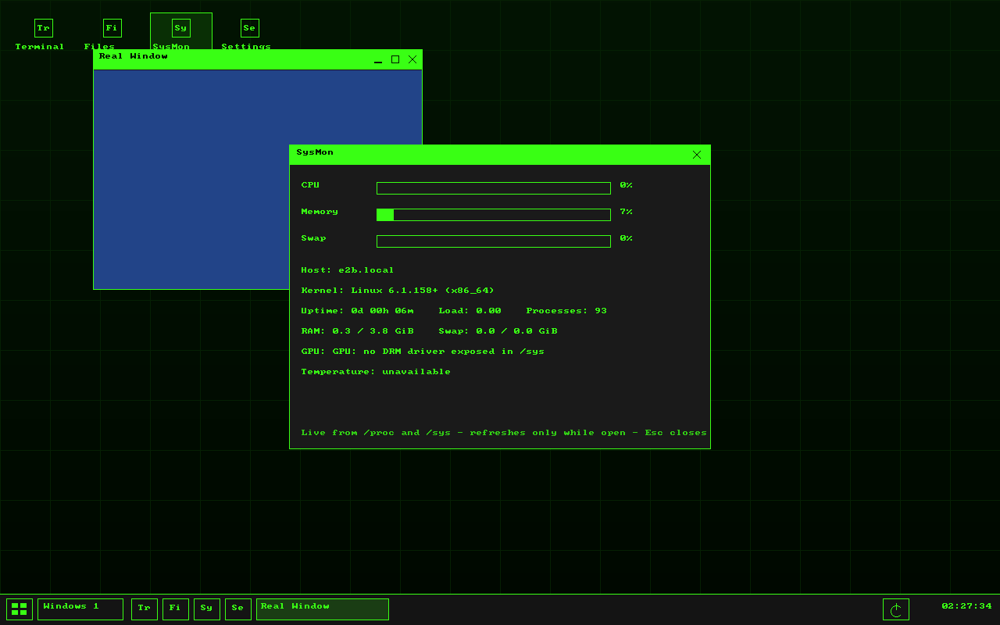

# scoswm — the SCos desktop experience as a real Linux window manager



`scoswm` is a small, non-compositing **X11 window manager** that manages
your ordinary Linux applications — terminals, browsers, editors, games —
while looking and behaving like the [SCos](https://github.com/Joercat/SCos)
desktop: the bottom taskbar with its 2×2-grid launcher, "Windows N"
picker, pinned shortcuts, power button and clock; desktop icons with
real freedesktop app images on a snap grid over a gradient+grid
wallpaper; 26 px titlebars with
minimise/maximise/close buttons; and the four SCos themes
(**Matrix** `matrix-1`, **Blue Sky** `blue-sky`, **Purple**
`midnight-purple`, **Matrix red** `amber-tech`) with the exact palettes
from SCos's `kernel/desktop/theme.c`.

An earlier version of this project ran the SCos desktop itself inside
one SDL window. That could only ever run SCos's built-in apps, so it
has been replaced wholesale by this window manager: same look, same
interaction model, real applications.

The app set is intentionally small. The retained SCos core is
**Terminal, Files, SysMon and Settings** — no games, demos or duplicate
utilities. Terminal and Files open your configured/detected Linux
programs; SysMon and Settings are tiny built-in panels. SysMon reads
only `/proc` and `/sys` (including NVIDIA proprietary vs nouveau
detection) and only samples while open. Settings changes the theme,
taskbar height, program choices and pins, applies them live and saves
the normal config file.

## Why X11 (and why it is the lightweight choice)

- **One code path for your GPU.** Xorg runs on the NVIDIA proprietary
  driver and on nouveau with identical behaviour — no per-driver
  compositor quirks. Intel/AMD work the same way for when you need them.
- **GPU acceleration stays on.** There is no software compositor to
  bypass or accelerate: OpenGL/Vulkan clients render directly through
  Xorg and the GPU driver (GLX/DRI on NVIDIA proprietary and nouveau),
  while `scoswm` itself only draws window decorations and the taskbar.
  Idle cost is a few MB of RAM and ~0% CPU (it blocks on the X
  connection and wakes once a second for the clock).
- **Wayland programs still work** through XWayland, which every major
  toolkit supports.

The only runtime dependencies are `libX11` and zlib (the latter is
used to decode standard PNG app icons).

## Install

Arch (this repo ships a `PKGBUILD`):

```sh
makepkg -si
```

Any distro:

```sh
make
sudo make install          # /usr/bin/scoswm, session files under /usr/share
```

Then pick **SCosWM** in your display manager, or from a TTY:

```sh
echo 'exec scoswm-session' >> ~/.xinitrc
startx
```

## Using it

| Action | How |
|---|---|
| Open the app launcher | Click the 2×2 grid button, or `Super+D`. The normal view shows only core/pinned apps; typing searches installed apps too |
| Launch pinned apps | Taskbar pin squares, or double-click desktop icons |
| Add/remove Home apps | Right-click the desktop and choose **Add/Remove App...**, or right-click any searched app in the launcher. Pinned apps appear on the desktop and taskbar and are saved in `pins` |
| Window list | "Windows N" taskbar button |
| Move / resize | Drag the titlebar / bottom-right grip, or `Alt+drag` / `Alt+right-drag` anywhere |
| Minimise / maximise / close | Titlebar buttons, double-click titlebar to maximise, or right-click titlebar/taskbar button for a menu |
| Cycle windows | `Alt+Tab` / `Alt+Shift+Tab` |
| Terminal | `Super+Enter` |
| SysMon / Settings | `Super+M` / `Super+,`, or their desktop/taskbar icons |
| Close focused window | `Alt+F4` or `Super+Q` |
| Minimise / maximise focused | `Alt+F9` / `Alt+F10` |
| Desktop menu | Right-click the desktop |
| Power menu | Taskbar power button: lock, restart/exit the WM, suspend, reboot, power off (via `systemctl`) |

Desktop, taskbar and launcher icons are the apps' real
`Icon=` images, resolved from the freedesktop icon theme and
`/usr/share/pixmaps` (PNG/XPM) at the normal small sizes — 24 px on
the desktop, 20 px in taskbar pins and 16 px beside running-window
titles. Icons are decoded once and cached as X pixmaps; an app with no
readable PNG/XPM icon keeps the SCos letter-glyph fallback rather than
growing the layout.

The launcher's normal view is deliberately curated to the four core
apps plus your pins. Once you type, it also searches `.desktop` files
from `~/.local/share/applications`, `/usr/local/share/applications`
and `/usr/share/applications`, so Firefox, Steam, VS Code and other
installed programs are available without cluttering the default view.

## Configuration

`~/.config/scoswm/scoswm.conf` (see `packaging/scoswm.conf.example`):

```ini
theme = blue-sky
terminal = alacritty
pins = terminal, files, sysmon, settings, firefox, code
bar_height = 40
```

The built-in **Settings** panel applies themes and taskbar height
live and saves this file; editing it by hand also works. The
power/desktop menus have a **Restart WM** entry that keeps your
windows open. An optional `~/.config/scoswm/autostart.sh` is run by
`scoswm-session`.

There are deliberately **no multiple workspaces**: one workspace, no
pager, no workspace daemon and no extra background process.

`scoswm --theme blue-sky` overrides the theme for one run;
`scoswm --config FILE` loads a specific config. `SCOSWM_DEBUG=1`
logs X errors.

## Development

```sh
make check
```

runs unit tests for the pure logic (SCos theme values, config and
`.desktop` parsing, Exec field-code stripping, UTF-8 titles — all in
`src/util.c`, no X server needed) and, when Xvfb is available, an
integration test that boots the WM, manages a real Xlib client
(`tests/testclient.c`) and verifies adoption through the window tree
(`tests/xprobe.c`). Without any X server the integration step reports
SKIP.

`PORTING.md` documents how each piece of the SCos desktop maps onto
this WM and where real-application behaviour necessarily differs.

## Layout

- `src/scoswm.c` — the window manager (Xlib, EWMH/ICCCM)
- `src/util.c` — X-independent helpers: themes, config, `.desktop` discovery, Linux `/proc` parsers
- `packaging/` — display-manager session, example config, session script
- `tests/` — unit tests, integration harness client/probe
